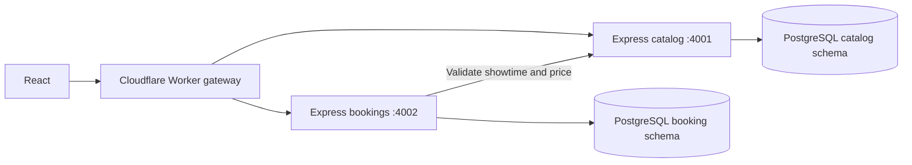

# Druk Cinema Booking

React cinema frontend with independent Node.js / Express REST services, PostgreSQL persistence, and a Cloudflare Worker gateway. Implemented on `feature/frontend-microservices`.

## Start locally

Requires Node.js 22+, npm, Docker with Compose, and WSL when working from Windows.

```sh
npm ci
cp .env.example .env
# Change POSTGRES_PASSWORD in .env to a URL-safe local password.
docker compose up --build -d
npm run dev
```

Open http://localhost:5173. Vite proxies API calls to catalog on port 4001 and bookings on port 4002.

The frontend also works without Docker: it switches to an explicitly labeled preview with sample films. Reservations are disabled in preview. The film descriptions and ratings are sample content; the Unsplash images are illustrative artwork, not official film posters. Replace them with licensed film assets before release. Fonts and images require internet access.

## Features

- Responsive dark-and-orange design inspired by the supplied screenshots.
- Movie search, genre filtering, new releases, horizontal browsing.
- Saved movies in browser local storage.
- Accessible native dialog for details, showtimes, and 60-seat selection.
- Database-backed reservations with customer validation and confirmation references.
- Unique seat constraints and transactions prevent double booking.
- Server-side price calculation; the browser cannot choose its own price.
- All showtimes displayed in Bhutan time (Asia/Thimphu).

No payments, authentication, booking cancellation, or email sending are implemented. A confirmation reference is displayed for the visitor to save. Anonymous booking is intended for development; authentication, abuse protection, privacy controls, and operational monitoring remain production work.

## Architecture



Services own separate schemas in a shared local PostgreSQL instance. Booking records store showtime IDs without cross-service foreign keys. There is no shared in-memory booking state. For production, provision separate service database credentials or databases; the local Compose setup uses one development account.

## REST endpoints

| Method | Endpoint | Result |
| --- | --- | --- |
| GET | /api/movies | Movie catalog |
| GET | /api/showtimes?movieId=1 | Upcoming showtimes |
| GET | /api/bookings/seats?showtimeId=1 | Reserved seat IDs |
| POST | /api/bookings | Create reservation |
| GET | /health (each Express service) | Database health |

Reservation body:

```json
{"movieId":1,"showtimeId":1,"seats":["A1","A2"],"name":"Pema Dorji","email":"pema@example.com"}
```

Returns 201 with `reference`, `seats`, and server-calculated `total`; 400 for validation; 409 for occupied seats; 503 for service failures. Seat IDs span A1–F10, up to eight distinct seats per reservation.

## Cloudflare Worker

```sh
npm run dev -w @druk/gateway
```

For deployment, set `CATALOG_URL` and `BOOKINGS_URL` to externally reachable HTTPS service origins in `services/gateway/wrangler.toml`. Set `FRONTEND_ORIGIN` to the exact frontend origin. Localhost addresses work only during local development. Run `npm run deploy -w @druk/gateway` after Cloudflare login.

Set `VITE_API_URL` in `frontend/.env` to the deployed Worker origin, then `npm run build`. Host `frontend/dist` on your static hosting platform. Keep Express and PostgreSQL on infrastructure supporting Node.js and persistent PostgreSQL; they do not run inside a Worker. No deployment has been performed.

CORS restricts browser origins; it is not authentication.

## Database lifecycle

The initialization script seeds six sample films and showtimes for the next 14 days, once when the database volume is created. Reservations persist across service restarts. Update showtimes through your database tooling when they expire. Schema changes need a migration on existing databases; editing init.sql will not alter an existing volume. `docker compose down` preserves data.

## Checks

```sh
npm test
npm run build
docker compose config --quiet
```

Use Postman or curl for API inspection. To check concurrency, submit two reservations for the same showtime and seat; exactly one should return 201 and the other 409.

## Suggested branch workflow

This complete foundation is on `feature/frontend-microservices`. After merging it, create independent branches for future frontend features, such as `feature/frontend-auth` or `feature/frontend-booking-history`. Do not split the current interdependent foundation across diverging branches.
