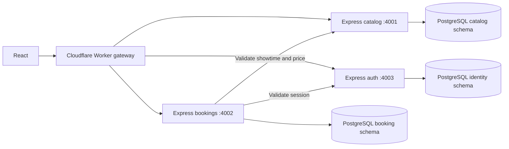

# Druk Cinema Booking

React cinema frontend with independent Node.js / Express REST services, PostgreSQL persistence, and a Cloudflare Worker gateway. Implemented on `frontend`.

## Start locally

Requires Node.js 22+, npm, Docker with Compose, and WSL when working from Windows.

```sh
npm ci
cp .env.example .env
# Change POSTGRES_PASSWORD in .env to a URL-safe local password.
docker compose up --build -d
npm run dev
```

Open http://localhost:5173. Vite proxies API calls to catalog on port 4001 and bookings on port 4002.

The frontend also works without Docker: it switches to an explicitly labeled preview with sample films. Reservations are disabled in preview. Film descriptions and ratings are sample content. Movie artwork is imported from frontend/image; confirm usage rights before release. Google Fonts require internet access; local posters do not.

## Features

- Responsive dark-and-orange design inspired by the supplied screenshots.
- Movie search, genre filtering, new releases, horizontal browsing.
- Saved movies in browser local storage.
- Accessible native dialog for details, showtimes, and 60-seat selection.
- Database-backed reservations with customer validation and confirmation references.
- Unique seat constraints and transactions prevent double booking.
- Server-side price calculation; the browser cannot choose its own price.
- All showtimes displayed in Bhutan time (Asia/Thimphu).

Registration, login, session restoration, and logout are implemented. Booking creation requires a valid session. Online payments, password recovery, and email verification are not implemented. Booking history, a no-cancellation policy, PDF tickets, and optional SMTP ticket email are implemented. My List remains browser-local; it is not synchronized between devices or stored per account.

## Architecture



Services own separate schemas in a shared local PostgreSQL instance. Booking records store showtime IDs without cross-service foreign keys. There is no shared in-memory booking state. For production, provision separate service database credentials or databases; the local Compose setup uses one development account.

## REST endpoints

| Method | Endpoint | Result |
| --- | --- | --- |
| GET | /api/movies | Movie catalog |
| GET | /api/showtimes?movieId=1 | Upcoming showtimes |
| GET | /api/bookings/seats?showtimeId=1 | Reserved seat IDs |
| POST | /api/bookings | Create reservation |
| GET | /health (each Express service) | Database health |

Reservation body:

```json
{"movieId":1,"showtimeId":1,"seats":["A1","A2"],"name":"Pema Dorji","email":"pema@example.com"}
```

Returns 201 with `reference`, `seats`, and server-calculated `total`; 400 for validation; 409 for occupied seats; 503 for service failures. Seat IDs span A1–F10, up to eight distinct seats per reservation.

## Cloudflare Worker

```sh
npm run dev -w @druk/gateway
```

For deployment, set `CATALOG_URL` and `BOOKINGS_URL` to externally reachable HTTPS service origins in `services/gateway/wrangler.toml`. Set `FRONTEND_ORIGIN` to the exact frontend origin. Localhost addresses work only during local development. Run `npm run deploy -w @druk/gateway` after Cloudflare login.

Set `VITE_API_URL` in `frontend/.env` to the deployed Worker origin, then `npm run build`. Host `frontend/dist` on your static hosting platform. Keep Express and PostgreSQL on infrastructure supporting Node.js and persistent PostgreSQL; they do not run inside a Worker. No deployment has been performed.

CORS restricts browser origins. Cookie-based authentication protects reservation creation.

## Database lifecycle

The initialization script seeds six sample films and showtimes for the next 14 days, once when the database volume is created. Reservations persist across service restarts. Update showtimes through your database tooling when they expire. Schema changes need a migration on existing databases; editing init.sql will not alter an existing volume. `docker compose down` preserves data.

## Checks

```sh
npm test
npm run build
docker compose config --quiet
```

Use Postman or curl for API inspection. To check concurrency, sign in and submit two authenticated reservations for the same showtime and seat; exactly one should return 201 and the other 409.

## Suggested branch workflow

This complete foundation is on `frontend`. After merging it, create independent branches for future frontend features, such as `feature/frontend-auth` or `feature/frontend-booking-history`. Do not split the current interdependent foundation across diverging branches.

## Login and registration

Start or update the services without deleting the existing database:

```sh
npm ci
docker compose up --build -d
npm run dev
```

Visit http://localhost:5173/#/register to create an account, or http://localhost:5173/#/login to sign in. Registration signs you in immediately. A normal login returns to the homepage. Opening a movie while signed out redirects to login and returns to that movie after successful login or registration. My List also preserves the intended destination. Only internal allowlisted return destinations are accepted. Browser Back closes movie details; refresh restores a valid session. Logout revokes the server-side session and redirects to login. Sessions are checked again when the window gains focus.

Auth runs on port 4003. Its startup creates the identity schema and tables if missing; bookings adds a nullable user_id column for existing data. No volume reset is needed. Earlier reservations remain intact. New reservations use the signed-in account's ID, name, and email from the server, ignoring browser-supplied identity fields.

| Method | Endpoint | Purpose |
| --- | --- | --- |
| POST | /api/auth/register | Name, email, password; creates account and session |
| POST | /api/auth/login | Email and password; issues a new session |
| GET | /api/auth/me | Current user, or 401 |
| POST | /api/auth/logout | Revokes current session and clears cookie |

Passwords use salted scrypt (N=131072, r=8, p=1). Session tokens are 32 random bytes; only their SHA-256 hashes are stored in PostgreSQL. Cookies use HttpOnly, SameSite=Lax, Path=/api, and a 7-day expiry. Tokens and passwords are never put in localStorage. Login errors do not reveal whether an email exists. Registration reports duplicate addresses. Database-backed rate limits cap attempts per email and service-visible network address. Behind the local proxy or Worker, users can share a network limit; production edge limits should also use a trusted client-IP source. Auth state-changing endpoints require JSON and reject unexpected browser origins.

For production HTTPS set COOKIE_SECURE=true and FRONTEND_ORIGIN to the exact frontend origin. Deploy the frontend and API on the same origin (preferred) or same-site subdomains; arbitrary cross-site domains do not work with SameSite=Lax cookies. Set AUTH_URL alongside the other service URLs in the Worker configuration. Cookie and Set-Cookie headers are forwarded by the gateway. Do not expose plain-HTTP service origins publicly.

Run the full account and booking integration test with Docker services running:

```sh
RUN_INTEGRATION=1 node --test tests/integration.test.js
```

The integration test creates test accounts and reserves one free seat. Unit tests cover salted passwords, invalid passwords, session cookie parsing, return-destination validation, and gateway cookie forwarding. No password reset emails or email verification are sent. Ticket emails are sent only through configured SMTP when the customer explicitly requests them.
## Customer booking interface

Open **My bookings** in the navigation, or http://localhost:5173/#/bookings. Signed-out visitors are redirected to login and returned to their booking history afterward.

The seat-selection flow now includes a review step with the film, showtime, seats, and server-calculated total. Customers acknowledge that payment is required during booking and that booked tickets cannot be cancelled. The confirmation screen and booking history offer a PDF reservation ticket. Tickets clearly say unpaid when no payment has been received. Customer identity is taken from the server session, and booking IDs alone do not grant access.

History shows the most recent 200 reservations, with Upcoming, Past, Cancelled, and All bookings filters. New reservations store a showtime snapshot; older authenticated bookings are enriched from the catalog on access. Earlier anonymous reservations cannot be assigned to an account automatically.

Bookings cannot be cancelled. The owner-facing cancellation endpoint returns 409 without changing booking status or releasing seats. Cancellation controls are removed. Historical cancelled records remain visible.

Each frontend submission includes a random requestId. Retrying the same request returns the existing reservation instead of creating another. Changing the seat selection generates a new ID.

| Method | Endpoint | Purpose |
| --- | --- | --- |
| GET | /api/bookings/mine | Current customer's booking history |
| GET | /api/bookings/options | Payment and email availability |
| GET | /api/bookings/:id/ticket | Owner-only PDF ticket |
| POST | /api/bookings/:id/cancel | Cancel eligible owned reservation |
| POST | /api/bookings/:id/email | Send ticket to the account email through SMTP |

POST endpoints require a JSON body (use {} for cancellation and email), an authenticated session, and an allowed browser origin.

### Bank of Bhutan payment status

BoB online payment is **not integrated**. Merchant documentation, sandbox configuration, transaction verification, callback authentication, and refund rules are needed before this can be implemented safely. No bank credentials, card numbers, PINs, or OTPs are collected. No simulated success is recorded. The API advertises payment.available=false. POST /api/bookings rejects all new requests with 503 PAYMENT_UNAVAILABLE until server-verified bank checkout is integrated. No new reservation is created and no seat is held.

### Optional email tickets

Set these in the root .env using your email provider's SMTP settings:

```dotenv
SMTP_HOST=
SMTP_PORT=587
SMTP_USER=
SMTP_PASSWORD=
SMTP_FROM=
```

Then rebuild/restart the booking container:

```sh
docker compose up --build -d bookings
```

Port 465 uses implicit TLS; other ports require STARTTLS. TLS certificate verification remains enabled. With incomplete settings, Email ticket is disabled and the API reports that email is not configured. With configuration present, the customer's explicit Email ticket action attaches their PDF and sends it to the email stored on their booking. A successful response means the SMTP service accepted the message, not that it reached the recipient's inbox. Requests are limited to five attempts per booking and at least two minutes apart. Real SMTP delivery has not been verified in this environment.

Expired or cancelled reservations remain visible in history. Previously downloaded PDFs must be checked against an active reservation at the cinema; no automated admission scanner is implemented. Do not treat the PDF as proof of payment.

The existing volume is preserved. Startup adds the new booking columns and backfills seat snapshots without dropping tables.
## Current policy — payment at booking, no cancellations

This policy supersedes any earlier reservation-only examples above.

- Payment must be verified before a ticket is booked. There is no pay-at-cinema option.
- Bank of Bhutan merchant integration is not configured. New booking requests return 503 PAYMENT_UNAVAILABLE, even if the browser sends a paid flag or transaction ID. Checkout is disabled until the bank flow can verify payments on the server.
- Bookings cannot be cancelled. Owner cancellation requests return 409 and never release seats; other users' bookings return 404.
- Existing records are preserved. Earlier unpaid reservations remain in history but cannot download or email tickets. Their seats are not automatically released or their payment state changed.
- Only confirmed, paid bookings can generate PDF or email tickets. SMTP configuration is still required for email.
- No real bank payment has been processed or simulated.

Run npm test and npm run build. With Docker services running, RUN_INTEGRATION=1 node --test tests/integration.test.js verifies blocked unpaid booking attempts, blocked unpaid ticket issuance, non-cancellation, and owner-only access. It uses explicitly seeded test records for paid/unpaid cases and removes those records afterward; it does not simulate a successful bank transaction.
## User profile and account recovery

Profile management and account recovery are now implemented. This supersedes the earlier list of missing profile, verification, and recovery features.

After logging in, choose **My profile**, or open http://localhost:5173/#/profile. You can update your name and optional phone number, view email verification status, change your password, request a verification email, and request an email-address change. Name changes affect future bookings; existing booking snapshots remain unchanged.

Changing a password requires the current password. All previous sessions and outstanding account links are revoked, and the current browser receives a new session. A new email address requires the current password and confirmation from the new inbox before replacing the existing login email. Confirming an email change revokes every session and requires login with the new address. A duplicate email cannot be adopted.

Choose **Forgot password?** on the login screen to request a reset link. SMTP must be configured before email requests are available. Reset responses do not reveal whether the account exists. Link delivery happens asynchronously; a generic request response is not proof of delivery. If mail fails or the service restarts before sending, request another link after the cooldown. The profile verification and email-change screens explicitly report unavailable SMTP or delivery errors.

Verification and reset links contain 32 random bytes, are stored only as hashes in the action-token table, expire after one hour, and can be used once. Verification is confirmed by an explicit POST action; merely opening a link does not consume it. The frontend removes link tokens from the address bar after opening the recovery screen. Refreshing that screen requires reopening the original email link. Password resets revoke all sessions and outstanding links, and require login afterward. Passwords are never emailed. Link origin comes from the configured FRONTEND_ORIGIN, not request Host headers. Rate limits apply to password, verification, and recovery actions.

Use the same SMTP_HOST, SMTP_PORT, SMTP_USER, SMTP_PASSWORD, and SMTP_FROM settings as ticket email. The Compose auth service now receives them. Restart with docker compose up --build -d auth after configuring SMTP. No development bypass returns secret links through the API or marks an email verified without a valid link. Existing accounts start unverified after the additive migration.

| Method | Endpoint | Purpose |
| --- | --- | --- |
| GET | /api/auth/profile | Current profile and email availability |
| POST | /api/auth/profile | Update name and optional phone |
| POST | /api/auth/password | Current-password-protected password change |
| POST | /api/auth/email/change | Request confirmation at a new email |
| POST | /api/auth/verification/request | Request current-email verification |
| POST | /api/auth/verification/confirm | Consume verification/email-change link |
| POST | /api/auth/password/forgot | Request password recovery email |
| POST | /api/auth/password/reset | Consume link and set new password |

Email verification is tracked but is not currently required to browse or log in. Booking payment and non-cancellation rules are unchanged. Real SMTP delivery and browser interaction remain manual verification steps.

Run the full account and booking integration checks:

```sh
RUN_INTEGRATION=1 node --test tests/integration.test.js tests/profile.integration.test.js
```

Tests seed known hashed recovery tokens directly in test-account records to verify consumption without sending real email; those test accounts are removed afterward. No production token-bypass endpoint exists. Reset email guidance: https://cheatsheetseries.owasp.org/cheatsheets/Forgot_Password_Cheat_Sheet.html
## Local demo payments

Demo checkout is implemented separately from Bank of Bhutan and does not process real money. It supersedes the payment-unavailable behavior only when explicitly enabled locally.

Set DEMO_PAYMENTS=true in the root .env and run docker compose up --build -d bookings. This has been enabled in the current local checkout. The checked-in example defaults to false. NODE_ENV=production always disables the simulator, even with DEMO_PAYMENTS=true.

Choose a movie, select seats, and open Review booking. The demo result selector can simulate success or decline. Acknowledge the demo notice, then choose Simulate payment & book. No card, account number, PIN, or OTP is requested. A decline returns 402 DEMO_DECLINED and creates no reservation or seat hold. A success calculates the price on the server, atomically reserves seats, and stores payment_status=demo_paid with a DEMO-prefixed reference. It never records a real paid transaction.

The confirmation, history, and downloaded PDF label the booking as a demo. Demo PDFs explicitly say NOT VALID FOR ADMISSION and NO MONEY CHARGED. Email delivery is disabled for demo tickets. Cancellations remain prohibited. Demo bookings occupy local seats so that seat-conflict behavior can be demonstrated; they are not valid cinema admissions. Existing unpaid and real-paid records are unchanged.

Duplicate request IDs return the existing demo reservation. Concurrent attempts for a seat cannot both book it. Real Bank of Bhutan integration remains unavailable, and turning demo mode off blocks new bookings again.

Run the demo integration checks with demo mode enabled:

```sh
RUN_INTEGRATION=1 node --test tests/demo.integration.test.js
```

CI runs the regular payment-unavailable checks first, then explicitly enables the simulator and tests success, decline, seat conflicts, duplicate requests, PDF downloads, and non-cancellation. Test-created demo bookings are removed afterward.
## Demo payment email OTP

Demo checkout now requires a Druk Cinema payment code before a successful simulated booking. Select seats, review the booking, acknowledge the demo notice, and choose Request payment code. Enter the six-digit code, then select Verify code & book demo.

With SMTP configured, the code is sent only to the logged-in account email. It is never sent to an email address supplied in the payment request, and the API does not return the code. Email-service acceptance is not a guarantee of inbox delivery. If SMTP is absent, the local demo explicitly shows a DEMO code and says no email was sent. This preview fallback is available only while the server permits demo payments. Neither mode is a real bank OTP or bank authorization, and neither charges money.

Codes expire after 5 minutes, allow at most 5 incorrect entries, and are tied to the account, request ID, movie, showtime, seats, and server-calculated amount. Resend cooldown is 60 seconds; the account can request at most 5 codes per 15 minutes. Codes are randomly generated and stored as salted hashes. A successful booking consumes its code in the same transaction that reserves seats. A declined demo payment takes no seats; it can be retried with the same unexpired code. Seat or price changes require a new code. Duplicate successful booking requests return the existing reservation.

Configure SMTP_HOST, SMTP_PORT, SMTP_USER, SMTP_PASSWORD, and SMTP_FROM in .env to receive real emails, then recreate the booking service. No SMTP credentials should be committed. Until configured, use the clearly labeled on-screen demo code.

New route: POST /api/bookings/payment/otp (authenticated JSON, demo enabled only). POST /api/bookings also requires the code in its otp field. Codes are not logged or persisted in browser storage. Live SMTP delivery remains unverified.
## Theatre selection

The booking dialog now starts with **Showtime & theatre selection**, followed by seats and payment review. Pick a date in Bhutan time, select a time at Cinema Hall or Lugar Theater, and choose Continue to seats. Change theatre returns to the selector and clears the seats and OTP for the previous show.

The venue labels follow the supplied reference. They are demo venue records in Thimphu, not a verified listing of all cinemas. Seat-row illustrations are decorative, not photos of the real venues. No distance or geolocation is invented. Times and prices are sample data, not live cinema schedules.

Catalog startup creates theatre records and adds theatre_id to showtimes. Existing showtime IDs and bookings are preserved, with legacy Hall 1 showtimes assigned to Cinema Hall. Existing booking snapshots remain unchanged. Idempotent sample schedules fill missing days for the next 14 days. Existing schedules on a day are kept. The showtime API includes theatre_id, theatre_name, and city.

Each theatre/date/time has a separate showtime ID, and occupied seats are keyed by showtime. Selecting A1 in one theatre does not take A1 at another. The server-selected showtime determines auditorium and price; venue information is carried into booking review, confirmations, history, and PDFs. Demo payment and non-cancellation policies are unchanged.
## Latest movie additions

All six previously unused posters are now in the catalog: Dorozam (1.jpg), Naba Sho (6.jpg), The Fearless (7.jpg), Samsara (9.jpg), and two entries labeled Title to be confirmed for 5.jpg and 13.jpg. Their English names have not been confirmed. Unverified release years, runtimes, genres, and audience ratings are left blank rather than invented.

The homepage shows a Latest additions row. New entries have New addition badges, and the lineup includes All movies, Latest additions, Now showing, and Showtimes coming soon filters. New & Popular includes the additions. These labels describe catalog additions, not verified current cinema releases.

Dorozam and Naba Sho have sample demo screenings in both theatres. The other four entries await schedules, show View details instead of a booking action, and return no bookable showtimes. These statuses are demo scheduling choices rather than claims about actual release dates. Future-showtime listings are filtered on the server as well as the UI.

Catalog startup applies movies.sql before theatre schedules. The additions are idempotent and existing movies and bookings are preserved. SQL data and frontend preview metadata use the same IDs and poster keys. Configure actual titles and schedules before publishing.