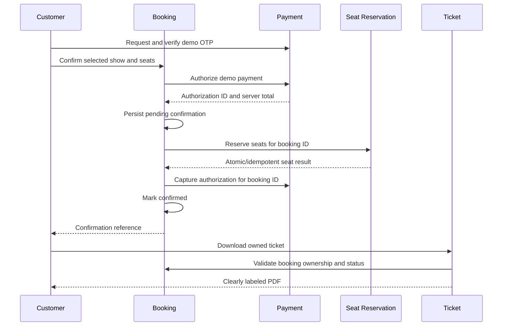

# Independent microservices

The implemented features now run as **13 independent Node.js backend services plus one Cloudflare Worker API gateway**. This maps 14 roles from the proposed 20-service diagram. It does not claim that the six unbuilt features are implemented.

## Service inventory

| Proposal | Service | Port | Owned schema | Main responsibility |
| --- | --- | --- | --- | --- |
| 01 | auth | 4003 | identity | Credentials, registration, sessions, passwords, email verification and recovery |
| 02 | profiles | 4004 | profiles | Canonical customer name, phone and profile details |
| 03 | cinemas | 4005 | cinemas | Cinema records and facility metadata |
| 04 | movies | 4001 | movies | Movie catalog, posters and listing status |
| 05 | showtimes | 4006 | showtimes | Theatre/movie schedules and prices |
| 06 | halls | 4007 | halls | Cinema-to-hall relationships and dimensions |
| 07 | seats | 4008 | seats | Hall-specific seat definitions |
| 08 | reservations | 4009 | reservations | Seat availability and atomic final reservations |
| 09 | payments | 4010 | payments | Demo OTPs, authorization and payment-state records |
| 11 | tickets | 4011 | tickets | PDF tickets and ticket-delivery request metadata |
| 13 | notifications | 4012 | notifications | SMTP delivery and delivery audit records |
| 15 | search | 4013 | search | Independent movie-search index |
| 19 | gateway | Worker | None | Public API routing and browser-origin policy |
| 20 | bookings | 4002 | booking | Booking history, snapshots and confirmation coordination |

The machine-readable backend inventory is services/manifest.json. Common utilities, the migration job and PostgreSQL are infrastructure, not additional business microservices.

**Not implemented:** 10 Discount, 12 QR Code, 14 Review & Rating, 16 Promotion, 17 Admin Management, 18 Reporting & Analytics.

The split preserves existing feature scope. Cinema/hall/movie/seat APIs currently expose the demo records and layouts; administrative CRUD screens are still missing. Seat Reservation prevents double booking but does not yet provide temporary customer seat holds. Payment remains a simulator, and email delivery requires SMTP configuration.

## Run

From Ubuntu/WSL in the project directory:

```sh
npm ci
npm run setup:env
docker compose up --build -d
npm run services:health
npm run dev
```

After images have been built, normal startup remains:

```sh
docker compose up -d
npm run dev
```

Open http://localhost:5173. Docker Desktop must be running. The frontend uses dedicated development proxies for the domain APIs. The Worker provides the equivalent routing for hosted deployments.

To rebuild and restart only one already-provisioned service:

```sh
docker compose build profiles
docker compose up -d --no-deps profiles
```

Every service has its own workspace package, process, HTTP port, container and image tag. The monorepo shares a Dockerfile and HTTP utilities; this does not require updating the other running service containers. Runtime services have normal HTTP dependencies, such as Profile requiring Authentication for identity checks.

## Database ownership

Local development uses one PostgreSQL server and database with service-owned schemas. Each service uses a distinct restricted runtime role. Runtime roles cannot read another service's schema; integration tests execute forbidden queries in each container to verify this. Booking cannot read the retired booking.seats or booking.demo_otps tables either.

Cross-service relationships use IDs and HTTP APIs rather than foreign keys or SQL joins across domains. Joins within a service-owned schema remain valid. Passwords and sessions stay in Authentication. Profile owns the editable name and phone; Authentication retains legacy registration metadata for compatibility and profile bootstrap, not as the canonical editable profile.

Only the one-shot **migrate** job has administrative database credentials. It performs additive schema setup, migration and role grants before application services start. Runtime services do not perform schema migrations. For production, schema migrations can be run as an operator deployment step and domains can be moved to separate PostgreSQL databases without permitting cross-service database access.

Run npm run setup:env to generate a server-only SERVICE_TOKEN and separate *_DB_PASSWORD values in the ignored .env file. Existing values and the current database password are preserved. CI uses test-only credentials. Do not commit .env or .backups. SERVICE_TOKEN protects internal mutation endpoints and is never forwarded from browser requests by the gateway. Production deployments should use HTTPS, a secret manager, and independently managed service identities.

## Existing data migration

A local pre-split database backup was saved under the ignored .backups directory before cutover. Existing accounts, sessions, profile values, movie IDs, showtime IDs, bookings, seats, OTPs and ticket-email metadata are copied or preserved.

The independent-services-v1 migration marker prevents repeated data copies from resurrecting old rows. Legacy catalog tables and the old booking.seats / booking.demo_otps tables remain migration archives; no active runtime service uses them. services/catalog is retained for legacy bootstrap SQL and is no longer a running Catalog container.

New canonical data:
- profiles.users, copied from legacy identity profile fields.
- movies.movies and cinemas.cinemas, copied from the old catalog.
- showtimes.slots, preserving old showtime IDs.
- halls.halls and seats.seats, containing the existing demo hall layouts.
- reservations.seats, copied from existing booked seats.
- payments.demo_otps and payments.otp_limits, preserving outstanding demo state.
- tickets.records, preserving ticket-delivery metadata.

Existing booking snapshots remain in booking.reservations. The deployment does not delete the database volume or automatically change old payment states.

## API boundaries

| Domain | Public API |
| --- | --- |
| Authentication | /api/auth/register, /login, /me, /logout, /password, /password/forgot, /password/reset, /verification/request, /verification/confirm, /email/change |
| Profile | GET/POST /api/profiles/me |
| Cinema | GET /api/cinemas and /api/cinemas/:id |
| Movie | GET /api/movies and /api/movies/:id |
| Showtime | GET /api/showtimes?movieId=… and /api/showtimes/:id |
| Hall | GET /api/halls?cinemaId=… and /api/halls/:id |
| Seat Management | GET /api/seats?hallId=… |
| Seat Reservation | GET /api/reservations/seats?showtimeId=… |
| Payment | GET /api/payments/options; POST /api/payments/otp and /api/payments/authorize |
| Ticket | GET /api/tickets/:bookingId/pdf; POST /api/tickets/:bookingId/email |
| Notification | GET /api/notifications/capabilities |
| Search | GET /api/search?q=…&genre=… |
| Booking | POST /api/bookings; GET /api/bookings/mine and /api/bookings/:id; POST /api/bookings/:id/confirm |

Old /api/auth/profile and /api/bookings/seats, /options, /payment/otp, /:id/ticket and /:id/email paths remain HTTP compatibility aliases. They forward to the owning service and do not access its database. The frontend uses the new canonical paths.

Each backend exposes GET /health for its own database readiness. Internal reservation creation, payment capture/void and notification sending are server-to-server endpoints protected by SERVICE_TOKEN; the Worker does not expose them.

## Booking coordination



No database transaction spans services. The workflow uses idempotent operations and a persistent pending_confirmation state. A transient failure can be resumed using the same booking request, or Retry confirmation in All bookings. Repeated capture cannot charge twice; the current payment implementation is demo-only and charges no money at all. Seat conflicts mark the failed attempt and void its unused demo authorization.

Booked tickets cannot be cancelled. The cancellation endpoint remains a policy rejection, not a seat-release operation. Demo records are stored as demo_paid, never as real paid transactions. Demo PDFs are not valid for admission. Real BoB integration and SMTP settings are still required for real payment and delivery.

## Notification and search behavior

Only Notification receives SMTP credentials. Authentication, Payment and Ticket call its authenticated HTTP API. Notification stores recipient, subject and delivery status, but does not persist OTP or password-reset message bodies. SMTP acceptance is not guaranteed inbox delivery.

Search maintains its own JSONB index, refreshed from Movie over HTTP with a short cache. Frontend searches call Search; the browser retains a local-filter fallback if Search is temporarily unavailable.

## Verification

```sh
npm test
npm run build
npm run services:health
RUN_INTEGRATION=1 node --test tests/*.test.js
npm run deploy -w @druk/gateway -- --dry-run
```

Integration checks cover per-service database isolation, profile ownership, account recovery, movies, both theatres, layouts, search, demo OTP success/decline, seat conflicts, duplicate requests, paid/demo ticket access and non-cancellation. Payment-unavailable policy tests require DEMO_PAYMENTS=false; demo checkout tests require true. CI exercises both modes.

Real SMTP delivery, real bank payments and production deployment are not verified. Browser interaction and usability review remain manual.


### Ticket QR codes
Confirmed paid/demo-paid bookings show a QR code in the booking confirmation, booking history and PDF. The code opens `#/ticket/<booking-id>`; the owner must sign in and backend ownership checks still apply. It is a ticket viewing link, not an admission check-in or single-use scanner.
Set `PUBLIC_APP_URL` in `.env` to the customer-facing frontend URL, then recreate Tickets with `docker compose up -d tickets`. The default is `http://localhost:5173`; to scan using a phone, use a LAN-accessible hostname/IP (and allow that frontend origin for authentication), or a deployed HTTPS frontend. Localhost refers to the scanning device and is not reachable as your computer from a phone. Existing PDFs keep their original links; download again after changing the URL. QR generation runs locally without sending booking details to a third-party image service. This feature is part of Ticket Service; a separate proposed QR Code Service is still not split out.


### Role-based login (RBAC)
Authentication owns the authoritative `user` and `admin` roles. Existing/new accounts default to `user`; registration/profile requests cannot assign roles. Login, session restoration and account-security responses carry the role. Both roles log in using the same form. Admins land on `#/admin` by default; explicit booking/ticket destinations are preserved. General users cannot access the admin page or `GET /api/auth/admin/users`; the backend checks the current database role on every request. Other customer features remain available to both roles with their existing ownership checks.
The admin dashboard is a paginated, read-only account directory. This is RBAC in Authentication, not the complete proposed Admin Management microservice or cinema administration UI.

To assign an admin, first register that person's account normally, then run from the Ubuntu project terminal (replace the example email):
```bash
docker compose run --rm --no-deps migrate node services/auth/scripts/set-role.js person@example.com admin
```
To remove admin access, use the same command ending in `user`. This trusted server command updates roles transactionally and revokes that account's sessions and recovery links. Log in again after changing roles. No public role-selection dropdown, default admin password or role-changing browser endpoint is provided.


### Scanning tickets from a phone while developing in WSL
A phone cannot reach your computer using `localhost`. Run `scripts/enable-phone-access.ps1` from Windows PowerShell **as Administrator**. The script forwards only frontend port 5173 to Ubuntu, allows that port from the local subnet, and sets `PUBLIC_APP_URL` plus allowed frontend origins. It does not expose database/backend ports. Then run `docker compose up --no-build -d` and keep `npm run dev` running in Ubuntu. Open the printed Wi-Fi URL on a phone connected to the same Wi-Fi before scanning a freshly loaded QR code. Sign in using the booking account. Download old PDFs again to get the corrected address. Rerun setup if the Windows/WSL IP changes. Guest/campus Wi-Fi may block communication between devices; use a shared personal hotspot if so.
